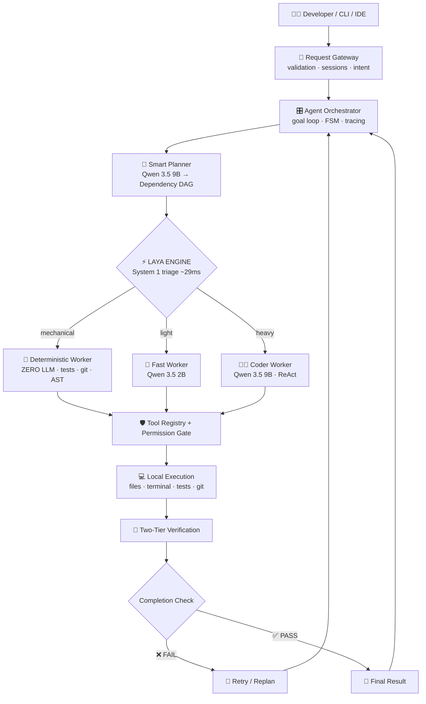

<div align="center">

```
███╗   ██╗██╗██╗  ██╗██╗  ██╗██╗
████╗  ██║██║██║ ██╔╝██║ ██╔╝██║
██╔██╗ ██║██║█████╔╝ █████╔╝ ██║
██║╚██╗██║██║██╔═██╗ ██╔═██╗ ██║
██║ ╚████║██║██║  ██╗██║  ██╗██║
╚═╝  ╚═══╝╚═╝╚═╝  ╚═╝╚═╝  ╚═╝╚═╝
```

### 🧠 AUTONOMOUS · 🔌 OFFLINE · 🔒 PRIVATE · ⚡ GPU-NATIVE
## The AI Software Engineer That Never Phones Home

**NIKKI plans. NIKKI routes. NIKKI codes. NIKKI tests. NIKKI fixes its own mistakes.**
**All on your GPU. Zero cloud. Zero API keys. Zero data leaving your machine.**

<br>


</div>

---

## 💀 WHAT IS THIS?

Most "AI coding assistants" are a thin wrapper around someone else's server.

**NIKKI is not that.**

NIKKI is a **fully autonomous software engineering agent** with its own brain, its own reflexes, its own hands, and its own internal QA department, running entirely on a single consumer GPU.

You give it a goal. It:

1. 🧩 **Decomposes** it into a dependency DAG of atomic subtasks
2. ⚡ **Triages** each subtask in **~29 ms** with a non-autoregressive decision engine
3. 🛠️ **Executes** with a permission-gated toolset (files, terminal, tests, git)
4. 🔍 **Verifies** with deterministic AST + unit tests, *then* a semantic LLM diff review
5. 🔁 **Self-corrects**: if verification fails, it retries or replans on its own

> **No cloud. No telemetry. No subscription. Pull the ethernet cable out and it still works.**

---

## 🎬 SEE IT IN ACTION

```bash
$ python cli.py "Create a function in src/math_utils.py that calculates fibonacci numbers and verify it with a unit test."
```

```
[GATEWAY]      ✔ Input sanitized · session a3f9…c1 · intent: coding
[PLANNER]      ✔ Qwen 9B → DAG of 3 subtasks (acceptance criteria attached)
[LAYA]         ✔ Routed in ~29ms → coder_worker · deterministic · deterministic
[CODER]        ✔ ReAct loop → writing src/math_utils.py
[PERMISSION]   ✔ WORKSPACE_WRITE granted · path contained
[VERIFY T1]    ✔ AST valid · unit tests passing
[VERIFY T2]    ✔ Semantic diff review passed
[ORCHESTRATOR] 🏁 GOAL COMPLETE
```

---

## 🏗️ THE ARCHITECTURE (it's a lot)



<details>
<summary><b>📟 Prefer the raw ASCII version? Click.</b></summary>

```
                           DEVELOPER / CLI / IDE
                                     │
                                     ▼
                              REQUEST GATEWAY
                   (Input validation, session management)
                                     │
                                     ▼
                             AGENT ORCHESTRATOR
                   (Goal loop, state machine, execution tracing)
                                     │
                                     ▼
                            SMART PLANNER — QWEN 9B
                   (Decomposes objectives into dependency DAGs)
                                     │
                                     ▼
                                LAYA ENGINE
                   (Fast ~29ms System 1 triage & worker routing)
                                     │
         ┌───────────────────────────┼───────────────────────────┐
         ▼                           ▼                           ▼
 DETERMINISTIC WORKER            FAST WORKER                CODER WORKER
   (Zero-LLM execution)          (Qwen 3.5 2B)             (Qwen 3.5 9B)
 Tests, Git, AST, Syntax     Fast JSON & extraction     Architecture & Code gen
         │                           │                           │
         └───────────────────────────┼───────────────────────────┘
                                     │
                                     ▼
                      TOOL REGISTRY & PERMISSION GATE
                       (READ_ONLY / WRITE / SYSTEM)
                                     │
                                     ▼
                             LOCAL EXECUTION
                File read/write/patch │ Terminal │ Tests │ Git
                                     │
                                     ▼
                            VERIFICATION LAYER
                 Tier 1: Deterministic AST & Unit Tests
                 Tier 2: Qwen 9B Semantic Review & Diff Analysis
                                     │
                                     ▼
                              COMPLETION CHECK
                                ╱         ╲
                              FAIL        PASS
                               │            │
                         Retry/Replan   Final Result
```

</details>

---

## 🧬 THE SEVEN SUBSYSTEMS

### 🚪 1. Request Gateway &nbsp;`src/gateway/`
The bouncer. Sanitizes every input, rejects empty payloads, isolates sessions with **UUID4** identifiers, and classifies intent (`coding` · `debugging` · `testing` · `question` · `refactor`) *before* a single token is generated.

### 🧠 2. Smart Planner &nbsp;`src/planner/`
Powered by `qwen3.5:9b` (Q4_K_M). Turns vague human goals into a **directed acyclic graph** of atomic subtasks, complete with dependencies, tool categories, and **strict acceptance criteria**. Ships with automatic **JSON schema repair** and **fallback DAG creation**, because LLMs lie about JSON and NIKKI knows it.

### ⚡ 3. Laya System 1 Decision Engine &nbsp;`src/router/`
The reflex arc. A **~850 MB ModernBERT-large** backbone on `cuda:0` makes **non-autoregressive routing decisions in ~29 ms**. No token-by-token generation. Just instant triage.

| Route | What it handles | Cost |
|---|---|---|
| `deterministic` | git, test suites, syntax checks, raw file reads | **0 LLM tokens** |
| `fast_worker` | extraction, classification, short schemas | Qwen 2B |
| `coder_worker` | code synthesis, multi-turn reasoning, refactors | Qwen 9B |

🔒 **Confidence gating:** if Laya's confidence drops below **0.60**, it safely escalates to Qwen 9B. It knows what it doesn't know.

### 🦾 4. Specialized Workers &nbsp;`src/workers/`
- **🤖 DeterministicWorker**: calls tools directly with no LLM overhead. Roughly a **100× speedup** on mechanical tasks.
- **🏃 FastWorker**: `qwen3.5:2b` for lightweight language ops and parameter structuring.
- **🧑‍💻 CoderWorker**: `qwen3.5:9b` in an autonomous **ReAct tool-calling loop**. Runs code, reads the traceback, diagnoses the failure, and patches it.

### 🛡️ 5. Tool Registry & Permission Gate &nbsp;`src/tools/`

```
┌──────────────────┬──────────────────────────────────────────────┐
│ READ_ONLY        │ file read · dir listing · regex · AST search │
│ WORKSPACE_WRITE  │ file write · atomic line patching            │
│ SYSTEM_EXEC      │ subprocess · test runner · git               │
└──────────────────┴──────────────────────────────────────────────┘
```
- 🚧 **Path isolation**: no traversal outside the project workspace
- ☠️ **Destructive command blocking**: `rmdir /s /q C:\`, `del /f /s /q *`, `format` and friends are dead on arrival

### 🔬 6. Two-Tier Verification &nbsp;`src/verifier/`
**Nothing is "done" until it survives both tiers:**

| Tier | Method | Catches |
|---|---|---|
| **Tier 1** | Deterministic AST validation + automated test execution | Broken syntax, failing tests |
| **Tier 2** | Qwen 9B inspects the git diff against acceptance criteria | Hallucinated or half-finished implementations |

### 🗄️ 7. Shared Persistent Memory &nbsp;`src/memory/`
Offline SQLite (`.agent_state.db`) with composite primary keys `(session_id, id)`:

- 🧠 **Working Memory**: goals, subtasks, DAG state, agent messages
- 📚 **Project Memory**: architecture, conventions, file summaries with **SHA-256 staleness detection** that re-indexes changed files automatically
- 📜 **Execution History**: immutable audit log of every tool call, argument, exit code, and duration
- 🔎 **Context Retriever**: feeds the planner and workers exactly the history they need

---

## 🖥️ HARDWARE & VRAM BUDGET

Built, tested, and verified on:

| Component | Spec |
|---|---|
| 🎮 **GPU** | NVIDIA GeForce RTX 5060 Ti · 16 GB VRAM · Blackwell · CUDA 13.4 |
| 🧮 **CPU** | Intel Core i7-14700K · 20 cores / 28 threads |
| 💾 **RAM** | 32 GB DDR5 |
| 📦 **Models** | Dedicated drive `D:\AI_Models` |

### 🧱 Three models. One GPU. Zero swapping.

| Model | Params | Quant | VRAM | Runtime |
|---|---|---|---|---|
| `qwen3.5:9b` | 9B | Q4_K_M | ~5.3 GB | Ollama |
| `qwen3.5:2b` | 2B | Q4_K_M | ~2.1 GB | Ollama |
| `laya` | 421M | FP16 | ~1.6 GB | PyTorch CUDA |
| **TOTAL** | | | **~9.0 GB** | **~7.0 GB still free** 😎 |

---

## 🚀 LAUNCH SEQUENCE

### 1️⃣ Fire up Ollama
```powershell
$env:OLLAMA_MODELS = "D:\AI_Models\Ollama"
ollama serve
```

### 2️⃣ Lock it offline
Your `.env` enforces **total network isolation**:
```ini
OFFLINE_MODE=true
HF_HUB_OFFLINE=1
TRANSFORMERS_OFFLINE=1
HF_DATASETS_OFFLINE=1
OLLAMA_BASE_URL=http://127.0.0.1:11434
MODEL_STORAGE_DIR=D:\AI_Models
QWEN_PRIMARY_MODEL=qwen3.5:9b
QWEN_FAST_MODEL=qwen3.5:2b
LAYA_MODEL_PATH=D:\AI_Models\Laya\typed-decisions
```

### 3️⃣ Run the diagnostics dashboard
```bash
python cli.py --health
```

### 4️⃣ Unleash it
```bash
# One-shot autonomous goal
python cli.py "Create a function in src/math_utils.py that calculates fibonacci numbers and verify it with a unit test."

# Interactive mode
python cli.py
```

---

## 🧪 TEST SUITE

```powershell
$env:PYTHONPATH = "."
python -m unittest discover tests
```

| Suite | What it proves |
|---|---|
| `test_offline_and_adapters.py` | Offline constraints hold · Ollama connects · Laya infers |
| `test_memory.py` | SQLite persistence · composite keys · SHA-256 staleness · retrieval |
| `test_tools.py` | Permission tiers · file editing · AST linting · test runner · regex search |
| `test_routing_and_planner.py` | Laya routing · confidence gating · Qwen 9B DAG planning |
| `test_end_to_end_agent.py` | **The whole loop**: plan → route → execute → verify → complete |

---

## ⚖️ THE EIGHT LAWS OF NIKKI

> Break these and the architecture breaks.

1. 👑 **The Orchestrator owns the lifecycle.** State transitions are FSM-controlled.
2. 🧠 **The Planner decides WHAT.** Explicit DAG subtasks with acceptance criteria.
3. ⚡ **Laya decides WHICH.** Task semantics and tool affinity, routed in ~29 ms.
4. 🤖 **Deterministic offload.** Never invoke an LLM when plain code can do the job.
5. 🛡️ **Gated execution.** Every tool call is screened for security, containment, and argument validity.
6. 🗄️ **Unified shared memory.** Every worker reads and writes the same SQLite state engine.
7. 🔬 **Two-tier verification.** No completion without syntax, tests, *and* semantic diff review.
8. 🔁 **Controlled retries.** Failures trigger targeted retries or full replanning.

---

## 🗺️ REPO MAP

```
NIKKI/
├── 📂 src/
│   ├── gateway/     # Input validation, sessions, intent
│   ├── planner/     # Qwen 9B → dependency DAGs
│   ├── router/      # Laya System 1 decision engine
│   ├── workers/     # Deterministic · Fast · Coder
│   ├── tools/       # Registry + permission gate
│   ├── verifier/    # Two-tier verification
│   └── memory/      # SQLite working / project / history
├── 📂 benchmarks/
├── 📂 config/
├── 📂 docs/
├── 📂 tests/
├── 🐍 cli.py        # Command-line entry point
├── 🔧 start_ollama.ps1
├── 📄 .env.example
└── 📄 requirements.txt
```

---

## 🧠 WHY NIKKI HITS DIFFERENT

| | ☁️ Typical AI Coder | 🔥 **NIKKI** |
|---|---|---|
| Runs on | Someone else's servers | **Your GPU** |
| Your code goes to | The cloud | **Nowhere** |
| Needs internet | Yes | **No** |
| API bills | Yes | **None** |
| Routing | One giant model for everything | **29 ms reflex layer + tiered workers** |
| Mechanical tasks | Burn tokens | **Zero-LLM deterministic execution** |
| Verification | "Looks good to me" | **AST + tests + semantic diff review** |
| Memory | Forgets everything | **Persistent SQLite with staleness detection** |
| Safety | Hope | **Permission tiers + path isolation + command blocklist** |

---

<div align="center">

### ⭐ If this made you raise an eyebrow, star the repo. ⭐

**Built by [@JRiishi](https://github.com/JRiishi)**
*Your code. Your GPU. Your agent.*

```
 N I K K I   //   P L A N   ▸   R O U T E   ▸   B U I L D   ▸   V E R I F Y   ▸   R E P E A T
```

</div>