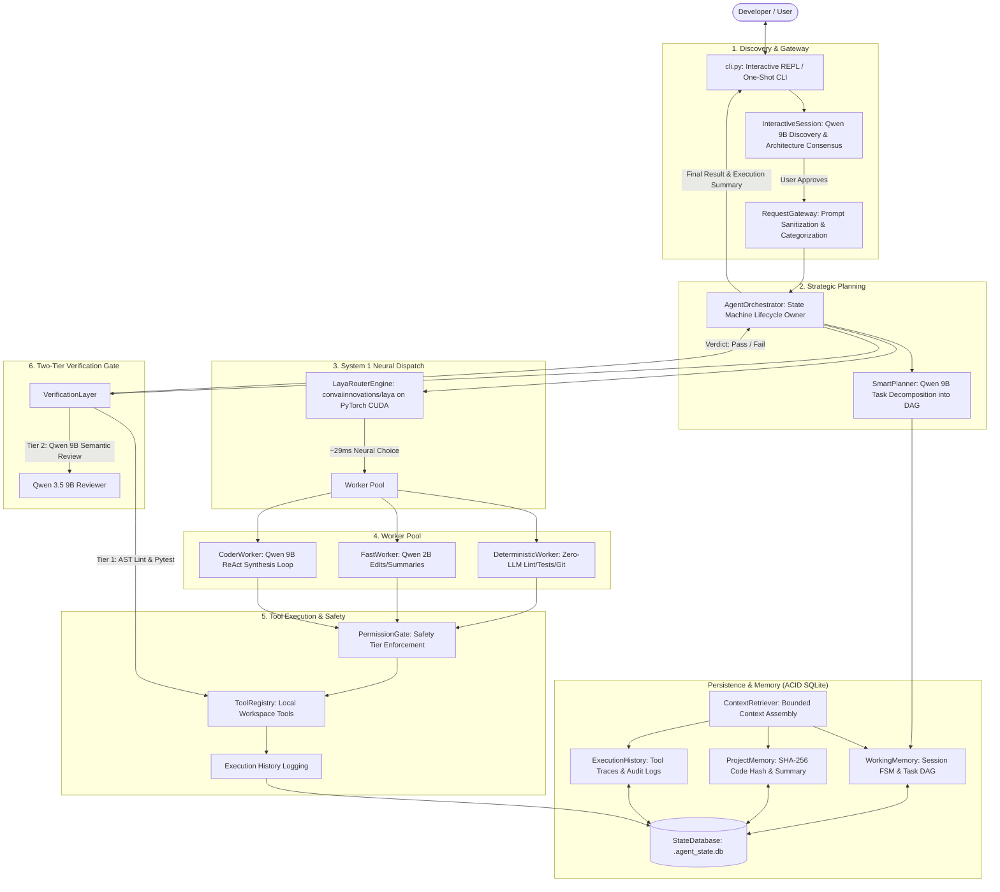
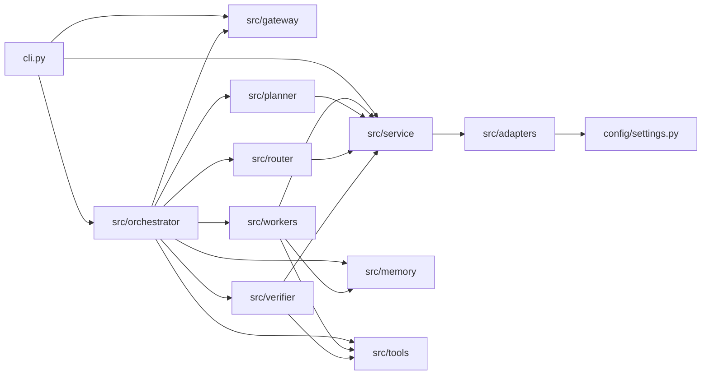

# NIKKI Architecture Documentation

## 1. System Overview

NIKKI is an autonomous local software engineering agent designed for 100% offline local inference on Windows 11 hardware (tested on NVIDIA GeForce RTX 5060 Ti 16GB VRAM, Intel Core i7-14700K, 32GB RAM). 

NIKKI does not call any external cloud APIs. All inference runs locally:
- **Primary LLM (9B):** `qwen3.5:9b` via Ollama (`127.0.0.1:11434`), loaded in 4-bit quantization (`Q4_K_M`, ~6.6GB VRAM). Used for conversational discovery, architectural DAG planning, multi-turn code synthesis (ReAct loop), and semantic code review.
- **Lightweight LLM (2B):** `qwen3.5:2b` via Ollama (`127.0.0.1:11434`), loaded in 8-bit quantization (`Q8_0`, ~2.7GB VRAM). Used for fast summaries, quick transforms, and light edits.
- **System 1 Neural Router:** `convaiinnovations/laya` (typed-decisions head, ~850MB FP16) loaded directly onto PyTorch CUDA (`cuda:0`). Evaluates criteria embeddings in ~29ms latency to select the optimal execution worker.
- **Deterministic Execution (Zero-LLM):** Following the *Ponytail Principle*, mechanical operations (AST linting, test suite execution, git commands, and file operations) are performed deterministically without wasting model tokens.

---

## 2. High-Level Architecture Diagram



---

## 3. Major Modules and Responsibilities

| Module | Files | Primary Responsibility |
|---|---|---|
| **Configuration** | `config/settings.py` | Pydantic v2 application configuration, VRAM limits, model paths (`D:\AI_Models\`), timeout constants, and directory resolutions. |
| **Model Adapters** | `src/adapters/` | Hardware-aware wrappers around local runtimes: `OllamaAdapter` (HTTP REST client with automatic headless daemon resurrection) and `LayaAdapter` (PyTorch CUDA FP16 embedding/decision engine). |
| **Model Service** | `src/service/model_service.py` | Central local model manager, VRAM safety monitor, unified `generate_text()`, `chat()`, and `laya_decide()` dispatcher. |
| **Interactive Gateway** | `src/gateway/` | `InteractiveSession`: Conversational discovery assistant (Qwen 9B) asking clarifying questions, drafting blueprints, and enforcing explicit user approval gating.<br>`RequestGateway`: Input validation, prompt sanitization, security checks, and task category inference. |
| **Memory & Storage** | `src/memory/` | `StateDatabase`: SQLite backend with composite primary keys and ACID guarantees.<br>`WorkingMemory`: Task DAG state machine (`PENDING`, `IN_PROGRESS`, `COMPLETED`, `FAILED`).<br>`ProjectMemory`: File structure caching with SHA-256 staleness checking.<br>`ExecutionHistory`: Comprehensive tool audit log.<br>`ContextRetriever`: Assembles bounded context windows per subtask. |
| **Planner** | `src/planner/smart_planner.py` | Prompts Qwen 9B with current workspace context to generate a structured dependency DAG (`List[TaskNode]`) formatted in strict JSON. |
| **Neural Router** | `src/router/laya_engine.py` | Evaluates task titles and criteria against worker semantic profiles using Convai Laya typed decisions (~29ms). Zero Python keyword bypasses. |
| **Workers** | `src/workers/` | `DeterministicWorker`: Ponytail principle implementation for test runs, AST linting, and git inspection.<br>`FastWorker`: Qwen 2B (~128 tok/s) for minor transforms.<br>`CoderWorker`: Qwen 9B multi-turn ReAct loop (up to 8 iterations) with tool-calling JSON protocol. |
| **Tools & Permissions** | `src/tools/` | `ToolRegistry`: Manages `read_file`, `write_file`, `patch_file`, `list_dir`, `run_command`, `run_tests`, `run_lint`, `git_status`, `git_diff`, `regex_search`, `symbol_search`.<br>`PermissionGate`: Tiers actions (`SAFE_READ`, `WORKSPACE_WRITE`, `DANGEROUS_SYSTEM`) with approval modes. |
| **Verification Gate** | `src/verifier/verification_layer.py` | Two-tier gate: (1) Deterministic AST & unit test execution, and (2) Cognitive code review with Qwen 9B analyzing targeted diffs and created project files. |
| **Orchestrator** | `src/orchestrator/orchestrator.py` | State machine driver owning the full lifecycle, managing retry escalation to `coder_worker_9b`, logging traces, and computing final execution summaries. |
| **CLI Studio** | `cli.py` | Rich terminal interface supporting interactive architectural chat, one-shot autonomous execution, and `--health` infrastructure inspection. |

---

## 4. Module Dependencies



---

## 5. Entry Points and Execution Flow

### 1. Interactive Discovery Studio (Default)
```bash
python cli.py
```
- Launches `InteractiveSession` REPL powered by Rich formatting.
- User chats freely with NIKKI (Qwen 9B) to refine requirements and design.
- NIKKI asks clarifying questions and proposes a formal `PROJECT BLUEPRINT`.
- When user approves (`approve` / `start`), `cli.py` invokes `orchestrator.run(approved_goal)`.
- Live pipeline runs, updates SQLite state, and injects execution summary back into chat memory.

### 2. Autonomous One-Shot Mode
```bash
python cli.py "Create a python module src/string_utils.py with a function slugify"
```
- Bypasses discovery chat and runs `orchestrator.run(goal)` directly under `FULL_AUTONOMOUS` mode.
- Prints rich status tables, tool execution statistics, and verification verdict.

### 3. Infrastructure Health Check
```bash
python cli.py --health
```
- Pings Ollama daemon on `127.0.0.1:11434` (auto-starts daemon if stopped).
- Verifies `qwen3.5:9b` and `qwen3.5:2b` model availability.
- Measures Laya FP16 decision latency on `cuda:0`.
- Measures total VRAM consumption via PyTorch CUDA.
