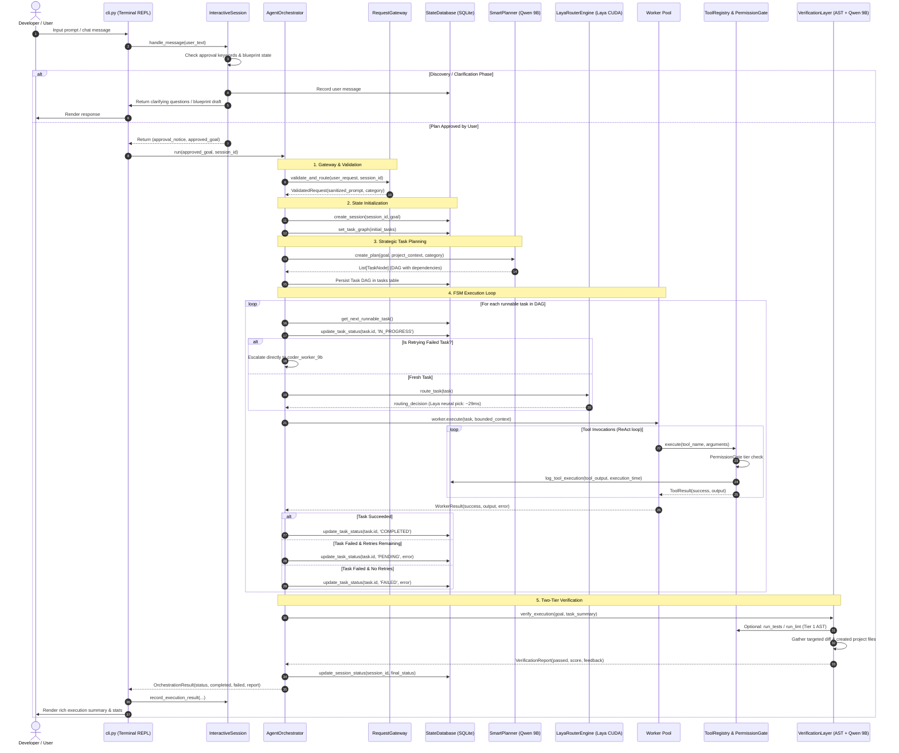

# Niiki Data Flow & Request Lifecycle

## 1. End-to-End Request Lifecycle Sequence



---

## 2. Detailed Data Transformations

### Phase 1: Developer Input → Validated Request
- **Input:** Raw text entered by developer in CLI REPL or CLI argument.
- **Transformation:** `RequestGateway.validate_and_route()`:
  - Validates minimum string length (>= 3 chars).
  - Sanitizes malicious shell injections (blocking dangerous commands like `rm -rf /`, `format`, `dd if=`).
  - Infers project category: `NEW_PROJECT`, `FEATURE_ADDITION`, `BUG_FIX`, `REFACTOR`, `TESTING`, or `GENERAL_SCRIPT`.
- **Output:** `ValidatedRequest` (Pydantic model containing `session_id`, `sanitized_prompt`, `inferred_category`, `metadata`).

### Phase 2: Goal → Task DAG (Planning)
- **Input:** Sanitized prompt + project context summary from `ProjectMemory`.
- **Transformation:** `SmartPlanner.create_plan()` prompts `qwen3.5:9b` with a structured system prompt requiring a strict JSON array.
- **Data Model:**
  ```json
  [
    {
      "id": "task_1",
      "title": "Scaffold project directory and modules",
      "description": "Create src/ and test/ folders with initial skeleton",
      "dependencies": [],
      "inputs": {"criteria": "Files exist on disk"}
    },
    {
      "id": "task_2",
      "title": "Implement core algorithm",
      "description": "Write implementation logic in src/module.py",
      "dependencies": ["task_1"],
      "inputs": {"criteria": "Syntax valid and passes linting"}
    }
  ]
  ```
- **Storage:** Persisted to SQLite `tasks` table with composite key `(session_id, id)`.

### Phase 3: Task → Worker Dispatch (Laya Neural Routing)
- **Input:** Active `TaskNode` object.
- **Transformation:** `LayaRouterEngine.route_task()` calls `convaiinnovations/laya` (typed-decisions FP16 on PyTorch CUDA).
  - Compares the task's semantic vector against three criteria:
    1. Deterministic operations (zero-LLM testing, linting, git).
    2. Lightweight generation (Qwen 2B summaries, simple transforms).
    3. Generative engineering (Qwen 9B code synthesis, multi-file editing).
  - Evaluates neural decision in ~29ms without any Python string pattern matching.
- **Fallback / Escalation:** If a worker returns `success=False` on its first execution, the orchestrator escalates the retry directly to `coder_worker_9b`.

### Phase 4: Worker ReAct Execution & Tool Operations
- **Input:** Bounded context assembled by `ContextRetriever` (task details + recent execution traces + project summary).
- **Execution:**
  - `CoderWorker` runs an autonomous ReAct loop for up to 8 iterations.
  - Generates JSON tool actions: `{"action": "call_tool", "tool_name": "...", "arguments": {...}}` or `{"action": "finish", "summary": "..."}`.
  - `ToolRegistry` evaluates the permission tier against `PermissionGate`.
  - Tool execution occurs locally; stdout/stderr and execution times are recorded in SQLite `execution_history`.

### Phase 5: Verification & Delivery
- **Input:** Goal, task completion ratio, created project files, and optional test outputs.
- **Transformation:** `VerificationLayer.verify_execution()`:
  - Scans created files using targeted discovery (prioritizing files and directories referenced in the goal and untracked in git status).
  - Inspects AST syntax validity and runs unit tests if available.
  - Sends the clean project files to `qwen3.5:9b` code reviewer with low temperature (`0.1`).
- **Output:** `VerificationReport` (`passed: bool`, `review_score: float`, `feedback: str`, `suggested_fix: str`).
- **Final Result:** `OrchestrationResult` returned to `cli.py` and displayed with Rich formatting.
